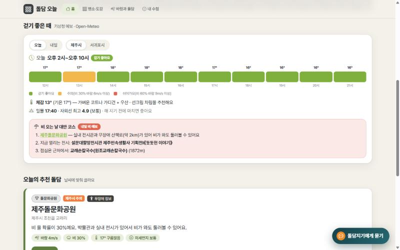
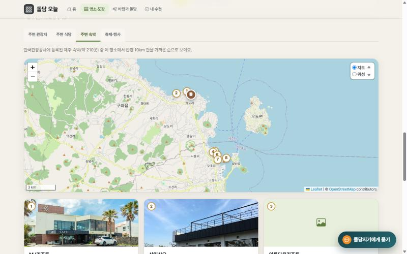
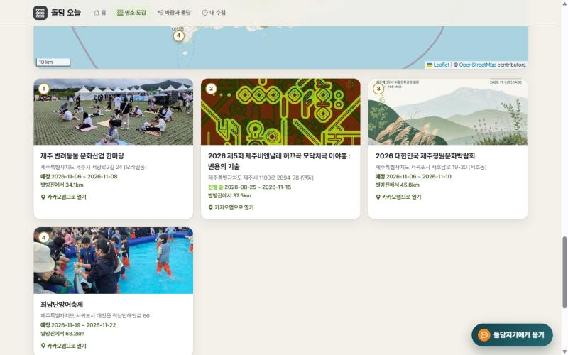

# 돌담 오늘 · 제주 돌담과 바람

배포 주소: https://doldam-today-jeju-project.vercel.app (GitHub: https://github.com/pjhjustin2430-cmd/doldam-today-jeju)

바람 많은 섬이 쌓은 제주 돌담(밭담·환해장성·진성·마을 돌담·방사탑·돌염전)을 날씨(바람·비·미세먼지)에 맞춰 골라 주고, 3D 돌담 모형으로 돌담이 바람을 늦추는 원리를 보여주는 웹앱. 돌담지기(AI 에이전트)는 모든 화면 오른쪽 대화창에서 쓸 수 있습니다.
공공데이터 5종(제주 무장애여행정보 CSV · 제주도청 돌문화공원 전시 API · 기상청 단기예보 · 에어코리아 · 관광공사 TourAPI) + AI 에이전트(돌담지기, 도구 6개) + Supabase 돌담 수첩.

## 실행
- 더블클릭: `start.bat` (처음이면 `npm install` 후 http://localhost:5173 을 열고 개발 서버 실행)
- 직접: `.env.example` 을 `.env.local` 로 복사해 값 채우기 → `npm install` → `npm run dev` (개발 서버가 `/api/*` 도 함께 처리)
- Supabase SQL Editor 에서 아래 실행 (돌담 수첩은 `source = 'doldam'` 으로 구분)

```sql
create table favorites (
  id bigint generated always as identity primary key,
  nickname text not null, source text not null, item_id text not null, title text not null,
  created_at timestamptz default now()
);
alter table favorites enable row level security;
create policy "read all" on favorites for select using (true);
create policy "insert all" on favorites for insert with check (true);
create policy "delete all" on favorites for delete using (true);
```

## 데이터
| 출처 | 쓰는 곳 |
|---|---|
| 제주특별자치도 무장애여행정보 40 돌문화공원 (CSV 2개 + 사진) | 실측 경로 170점·고도·구간별 접근성·사진 → 돌문화공원 상세 |
| 제주특별자치도 무장애여행정보 25 감수굴밭담길 + 관광지주변정보 (CSV 2개) | 경로·접근성·주변 시설 → 감수굴밭담길 상세 |
| 제주특별자치도청 오픈API 제주돌문화공원 전시 정보 (F06, 키 없음·XML) | 돌문화공원 상세의 "전시·행사", 에이전트 도구 |
| 한국관광공사 TourAPI KorService2 (`locationBasedList2`) | 명소 주변 관광지·식당·숙박·사진 |
| 기상청 단기예보 / 한국환경공단 에어코리아 | 바람·비·미세먼지 → 걷기 적합도, 오늘의 추천 |
| Open-Meteo 대기질 (CAMS 모델 추정, 키 없음) | 에어코리아가 한도 초과·장애일 때 미세먼지 대체값 (화면에 "모델 추정" 표시) |
| Open-Meteo Elevation (Copernicus DEM 90m, 키 없음) | 경로 파일에 고도가 없는 감수굴밭담길의 고도 프로필 |
| southkorea-maps (kostat 2013) | 해안선 → `src/data/jejuCoast.json` |

- 명소 데이터 만들기: `node scripts/buildDoldam.mjs` → `server/data/doldamSpots.json` 과 `public/doldam/stonepark/*.jpg`(사진을 960px 로 줄임)
- 감수굴밭담길·돌문화공원은 CSV 의 실측 좌표입니다. 나머지 12곳은 직접 정리한 대표 명소입니다. 이 중 7곳(별방진·성읍·가파도·구엄 돌염전·신흥리 방사탑·신산환해장성·신풍리 밭담길)은 한국관광공사 TourAPI 에 등록된 같은 이름의 관광지라 그 좌표와 사진을 쓰고("관광공사 좌표" 배지), 삼양 환해장성은 위키백과의 같은 이름 항목 좌표("위키백과 좌표"), 온평 환해장성은 성벽을 따라 난 환해장성로의 OpenStreetMap 좌표("지도 데이터 좌표")를 씁니다. 나머지 3곳(한담 환해장성, 우도, 김녕)은 OpenStreetMap Nominatim 으로 확인한 마을·해안 단위의 근사 위치입니다("근사 위치" 배지).
- 바람과 돌담(`/wind`, three.js): 현무암 돌을 틈을 두고 쌓은 3D 돌담 모형에 오늘 제주시 풍속(기상청 단기예보 WSD)으로 바람 줄기가 불어옵니다. 담 뒤에서는 줄기가 느려지고 주황색이 되며, 작물도 덜 흔들립니다. 바람 세기 슬라이더와 "돌담 치우기"로 비교할 수 있습니다. 담 뒤 감소량(바로 뒤 최대 55%, 담 높이의 몇 배 거리를 지나며 회복)은 원리를 보여주기 위한 **설명용 모형**이며 실측값이 아닙니다.
- 돌담지기: 예전 `/agent` 페이지 대신 오른쪽 아래의 작은 팝업 창입니다. "돌담지기에게 묻기" 버튼으로 열고 ×로 닫으며, 화면 내용을 밀지 않고 위에 뜹니다. 예전 주소 `/map`·`/agent` 는 새 화면으로 넘어갑니다.
- 서버 함수: `api/spots.js`(명소·종류) · `api/nearby.js` · `api/weather.js` · `api/air.js` · `api/agent.js`(도구: search_doldam_spots, get_spot_detail, get_weather, find_nearby_places, get_air_quality, get_stonepark_exhibitions) · `api/exhibitions.js`

## 지도
명소 상세의 지도는 Leaflet 으로 그리는 실제 지도입니다(키 불필요). 기본은 OpenStreetMap, 오른쪽 위에서 위성(Esri World Imagery)으로 바꿀 수 있고 밭담·돌담이 실제로 보입니다. 그 위에 실측 경로(고도 색)·안내 지점·가까운 관광지(번호 핀, 누르면 카카오맵)를 올립니다. 지도 하단에 출처가 표시되며, 두 타일 서버 모두 소규모·비상업 용도 기준입니다. 휠 확대는 페이지 스크롤을 방해하지 않도록 꺼 두었고 + − 버튼을 씁니다. "찾아가기"는 카카오맵 길찾기(좌표로 도착지 지정) 링크입니다.

## 배포 (Vercel)
GitHub 연결 후 Import → Environment Variables 에 `.env.example` 의 값 입력(`VITE_SUPABASE_URL`, `VITE_SUPABASE_ANON_KEY`, `DATA_GO_KR_KEY`, `ANTHROPIC_API_KEY`).

## 알려진 한계와 실서비스라면
- Supabase `favorites` 의 RLS 정책이 누구나 읽기·쓰기·삭제 가능(실습용)입니다. 실서비스라면 Supabase Auth 로 로그인하게 하고 `auth.uid() = user_id` 로 본인 행만 다루도록 정책을 바꿔야 합니다.
- 공공 API 호출 아낌이: `server/cache.js` 가 날씨 10분·미세먼지 20분·주변 장소 30분 메모리 캐시(실패하면 지난 값 사용)를 하고, 성공 응답에는 `Cache-Control: s-maxage=600` 을 붙여 Vercel CDN 이 10분 저장합니다. 에어코리아 개발계정은 하루 호출 한도가 작아서 개발 중 초과하기 쉽습니다(초과하면 다음 날 풀리고, 화면에는 미세먼지 "정보 없음"으로 나옵니다).
- `/api/agent` 는 IP당 10분 20회·질문 500자 제한이 있지만 서버리스 인스턴스별 메모리 기준이라 최소한의 방어입니다. 실서비스라면 Upstash 같은 외부 저장소로 세어야 합니다.
- "근사 위치" 배지가 붙은 3곳(한담 환해장성, 우도, 김녕)은 마을·해안 단위 위치입니다. 나머지는 실측 경로(2곳), 한국관광공사 등록 좌표(7곳), 위키백과 좌표(삼양), OpenStreetMap 환해장성로 좌표(온평)입니다.
- 주변 숙박: `locationBasedList2` 는 숙박이 거의 안 나와서, 관광공사 `searchStay2`(법정동 코드 lDongRegnCd=50) 로 제주 숙박 전체(약 210곳)를 받아 두고 명소와의 거리로 걸러 반경 10km 안을 가까운 순으로 보여 줍니다. 축제·행사는 `searchFestival2` 로 오늘 이후 제주 행사 전체를 가까운 순으로 보여 줍니다(`server/tour.js`).
- 관광공사 사진은 공공누리 제1유형(출처 표시)과 제3유형(출처 표시 + 변경 금지)이 섞여 있어, 제3유형 사진은 크기만 줄여서 쓰고 자르거나 합성하지 않습니다. 출처와 유형은 각 사진 아래에 표시됩니다.
- 돌담 사진은 `node scripts/fetchPhotos.mjs` 가 위키미디어 커먼즈(CC BY-SA)·공공누리 1유형 사진을 받아 `public/doldam/spots/` 에 저장하고, 작성자·라이선스·원본 링크를 `server/data/spotPhotos.json` 에 기록합니다. 사진이 없는 명소(별방진)는 사진 칸을 만들지 않고, 장소가 다른 사진은 캡션에 실제 장소를 밝힙니다. 반영은 `node scripts/buildDoldam.mjs`.

## 공유용 이미지
- QR 코드: `node scripts/makeQr.mjs [주소]` → `public/images/qr.png` (배포 주소로 가는 QR, 흰 바탕·검은 QR)
- OG 이미지·홈 화면 아이콘: `node scripts/makeOg.mjs` → `public/images/og.png`(1200x630), `icon-180.png`. 사진은 한국관광공사(공공누리 제1유형)이며 이미지 안에 출처를 적었습니다.

## 돌담지기를 Gemini 로 돌리기 (Claude 키가 없을 때)
`GEMINI_API_KEY`(Google AI Studio 무료 키)가 있으면 돌담지기가 Claude 대신 Gemini 로 답합니다(`server/gemini.js`). 도구 6개와 호출 내역 표시, 대화 저장은 그대로이고, 모델은 `GEMINI_MODEL`(기본 gemini-3.5-flash-lite)로 바꿉니다. `AGENT_PROVIDER=claude|gemini` 로 직접 고를 수도 있습니다. 가짜 Gemini 서버로 도구 호출 흐름(한 번에 3개, 다음 차례 4개)을 검증했고, 실제 Gemini 응답은 키를 넣은 뒤 확인합니다.

## 돌담지기 대화 기록
돌담지기와 나눈 대화는 닉네임별로 Supabase `favorites` 테이블에 저장되고(`source = 'doldam-chat'`, `title` = 질문, `item_id` = 답변·호출 내역 JSON), 팝업을 열 때 최근 40개 질문을 불러옵니다. 닉네임이 없으면 이 브라우저만의 번호로 저장해 다른 사람과 섞이지 않고, 대화 지우기 버튼은 저장된 기록도 함께 지웁니다. 별도 테이블 없이 기존 테이블을 쓰는 실습용 구조이며, 실서비스라면 `chat_logs` 테이블과 로그인이 필요합니다.

## 걷기 좋은 때 (홈·명소 상세)
기상청 단기예보를 1시간 간격(`/api/weather?day=hours`, 오늘 지금~21시)과 내일(`day=tomorrow`)로 받아 시간대마다 걷기 수준(걷기 좋아요/주의/쉬어가요: 비 30%·바람 6m/s 이상이면 주의, 비 60%·바람 9m/s 이상이면 쉬어가요)을 색 막대로 보여 주고, 가장 길게 이어지는 좋은 시간을 알려 줍니다. 체감온도(기온·습도·바람으로 계산한 추정)와 옷차림 한 줄, Open-Meteo(키 불필요, `/api/sun`)의 일몰 시각·자외선 지수를 함께 보여 줍니다. 홈 날씨 칩에는 내일 걷기 수준이 붙고, 비가 오는 날에는 "비 오는 날 대안 코스"(제주돌문화공원 + 도청 오픈API의 진행 중 전시 + TourAPI 근처 식당)가 강조됩니다. 계산은 `src/lib/walkTime.js`, 화면은 `src/components/WalkPanel.jsx` 입니다.

## 내 돌담 수첩 (돌벽 채우기)
도장을 찍으면 `내 수첩` 위쪽 돌벽(모양이 제각각인 돌 98개, 명소 하나 = 7개 묶음)의 빈 구멍이 돌로 채워집니다. 돌 배치는 `src/lib/stoneWall.js`(d3-delaunay 보로노이)가 늘 같은 모양으로 만들고, 기록은 Supabase `favorites` 에 저장됩니다. "아직 안 가 본 곳" 카드에서 바로 "도장 찍기"를 눌러 돌벽을 채울 수 있고(사진을 누르면 상세), 단계(돌 줍는 여행자 → 돌담 장인)와 "이미지로 저장"(1200x630 PNG)이 있습니다.

## 테스트 캡처
| 확인 항목 | 화면 |
|---|---|
| 홈: 공공 API(기상청 예보) 실제 데이터, 종류별 돌담 지도 |  |
| 명소·도감: 관광공사 사진·출처, 위치 배지 |  |
| 명소 상세: 무장애여행정보 실측 경로를 실제 지도 위에 |  |
| 바람과 돌담: 기상청 풍속으로 움직이는 3D |  |
| 내 수첩: Supabase 저장 → 새로고침 후에도 돌벽 유지 |  |
| 홈: 시간대별 걷기 좋은 때 · 체감온도·옷차림 · 일몰·자외선 · 비 오는 날 대안 코스 |  |
| 상세: 숙박 보강(제주 숙박 전체에서 거리로) |  |
| 상세: 축제·행사 탭 |  |

배포본 서버 함수 확인(2026-11-03): `/api/weather`, `/api/air`(에어코리아 실측), `/api/spots`, `/api/exhibitions`(돌문화공원), `/api/nearby`(TourAPI) 모두 200 응답. 돌담지기(`/api/agent`)는 Claude 키 교체 후 캡처를 추가합니다.

발표 자료: `docs/돌담오늘_발표자료.pptx`(19장, 모든 기능 소개) · 대본 `docs/발표_대본.md` · 시연 영상 대본 `docs/시연_영상_대본.md`
